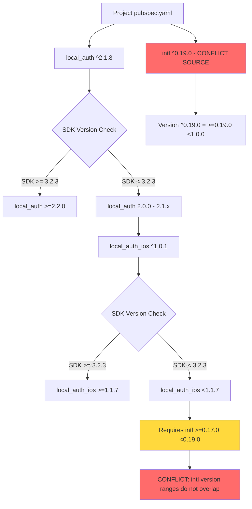

# Flutter Dependency Conflict Fix Plan

## Problem Summary

The Flutter project in the `version/` directory is experiencing a dependency version solving failure when running `flutter pub get`.

## Root Cause Analysis

### Error Message Breakdown

```
The current Dart SDK version is 3.0.6.

Because local_auth_ios <1.0.12 depends on intl ^0.17.0 and local_auth_ios >=1.0.12 <1.1.7 depends on intl >=0.17.0 <0.19.0, 
local_auth_ios <1.1.7 requires intl >=0.17.0 <0.19.0.

And because local_auth_ios >=1.1.7 requires SDK version ^3.2.3, 
every version of local_auth_ios requires intl >=0.17.0 <0.19.0.

Because local_auth >=2.2.0 requires SDK version >=3.2.3 <4.0.0 and local_auth >=2.0.0 <2.2.0 depends on local_auth_ios ^1.0.1, 
local_auth >=2.0.0 requires local_auth_ios ^1.0.1.

Thus, local_auth >=2.0.0 requires intl >=0.17.0 <0.19.0.

So, because sensative_data_drive depends on both local_auth ^2.1.8 and intl ^0.19.0, version solving failed.
```

### Dependency Chain Diagram



### Key Issues Identified

| Issue | Current State | Required State | Conflict |
|-------|---------------|----------------|----------|
| Dart SDK | 3.0.6 | >=3.2.3 for latest local_auth | Yes |
| intl package | ^0.19.0 per error | >=0.17.0 <0.19.0 for local_auth_ios | Yes |

**Note:** The current [`pubspec.yaml`](version/pubspec.yaml:32) shows `intl: ^0.18.1`, but the error indicates `intl ^0.19.0` was being resolved. This suggests either:
1. The pubspec.yaml was recently modified but `flutter pub get` was not re-run
2. A dependency override or lock file is causing the conflict

---

## Solution Options

### Option 1: Upgrade Dart SDK (Recommended)

**Description:** Upgrade the Flutter/Dart SDK to version 3.2.3 or higher.

**Pros:**
- Access to latest package versions and features
- Better long-term maintainability
- Security updates and bug fixes

**Cons:**
- May require code changes for breaking changes
- Team members need to update their Flutter installation

**Steps:**
1. Run `flutter upgrade` to update to the latest Flutter/Dart SDK
2. Verify with `flutter --version` that Dart SDK is >=3.2.3
3. Update [`pubspec.yaml`](version/pubspec.yaml:7) SDK constraint to `>=3.2.3 <4.0.0`
4. Run `flutter pub get`

---

### Option 2: Downgrade intl Package (Quick Fix)

**Description:** Change the intl package version constraint to be compatible with local_auth_ios.

**Pros:**
- Quick fix, no SDK upgrade required
- Works with current development environment

**Cons:**
- May miss features from newer intl versions
- Technical debt - will need to address later

**Steps:**
1. Update [`pubspec.yaml`](version/pubspec.yaml:32) to change `intl: ^0.18.1` to `intl: ^0.18.0` or `intl: ">=0.17.0 <0.19.0"`
2. Delete `pubspec.lock` to force fresh resolution
3. Run `flutter pub get`

---

### Option 3: Use local_auth with Platform-Specific Implementations

**Description:** Use newer local_auth that uses separate platform packages.

**Pros:**
- More granular control over platform dependencies
- May resolve version conflicts

**Cons:**
- Requires SDK upgrade to 3.2.3+
- More complex dependency management

---

## Recommended Solution

**Option 1 (Upgrade Dart SDK)** is recommended for long-term project health.

### Implementation Plan

- [ ] **Step 1:** Verify current Flutter version
  - Run `flutter --version` to confirm current SDK version
  
- [ ] **Step 2:** Upgrade Flutter
  - Run `flutter upgrade` to get the latest Flutter and Dart SDK
  
- [ ] **Step 3:** Update pubspec.yaml SDK constraint
  - Change line 7 from `sdk: '>=3.0.0 <4.0.0'` to `sdk: '>=3.2.3 <4.0.0'`
  
- [ ] **Step 4:** Update dependencies
  - Run `flutter pub get` to resolve dependencies
  
- [ ] **Step 5:** Verify the fix
  - Ensure no errors during dependency resolution
  - Run `flutter analyze` to check for any code issues

---

## Files to Modify

| File | Change Required |
|------|-----------------|
| [`version/pubspec.yaml`](version/pubspec.yaml:7) | Update SDK constraint and potentially intl version |
| [`version/pubspec.lock`](version/pubspec.lock:1) | Will be regenerated after `flutter pub get` |

---

## Validation Checklist

After implementing the fix:
- [ ] `flutter pub get` completes without errors
- [ ] `flutter analyze` shows no critical issues
- [ ] `flutter build apk` or `flutter build ios` succeeds
- [ ] App runs correctly on target platforms